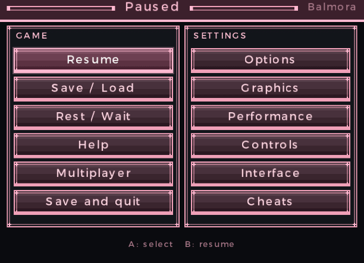
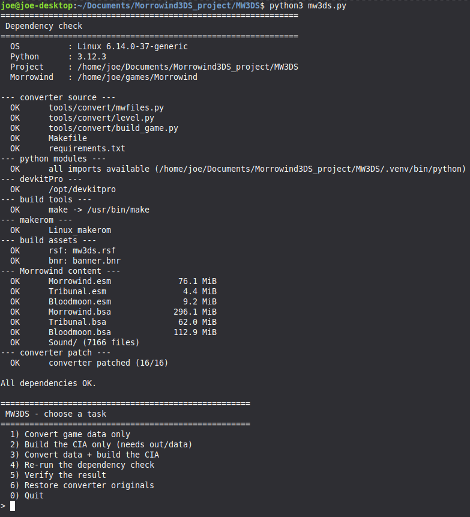

# MW3DS Tweaks

> **Morrowind for Nintendo 3DS**  
> Featuring new tools, improved menus, controller support, and quality-of-life improvements.

---

▶️ **[Watch on YouTube]([https://www.youtube.com/)](https://www.youtube.com/watch?v=jySDhc875KY)**

---




Install script:


## 🎮 Features

| Feature | Description |
|---------|-------------|
| **Multiplayer** | Multiplayer functionality |
| **Cheats** | God mode, unlimited resources, extra gold, and teleportation |
| **Custom UI Styles** | Different interface styles and improved menus |
| **Virtual Joysticks** | On-screen joystick controls |
| **Controller Support** | Play with a connected game controller |
| **Key Remapping** | Customize keyboard and controller buttons |
| **Improved Menus** | Expanded pause menu with graphics, performance, and interface settings |
| **Performance Options** | Adjust draw distance, FPS, and visual effects |
| **Tribunal & Bloodmoon** | Support for the official expansions |
| **Terminal Commands** | Send commands to the game through a terminal |
| **Camera Preview** | Small camera preview window on your PC |

---

## 💻 Installation

### 🐧 Linux

```bash
# Clone the repository
git clone --recurse-submodules https://github.com/floowsnaake-new/mw3ds-tweaks.git
cd mw3ds-tweaks

# Install dependencies
sudo apt install python3 python3-pip python3-venv git

# Set up virtual environment
python3 -m venv .venv
source .venv/bin/activate

# Install Python packages
pip install -r requirements.txt

# Launch
python3 mw3ds.py
```

### 🪟 Windows

1. Install [Python 3](https://www.python.org/downloads/) — **enable "Add Python to PATH"** during installation.
2. Install [Git for Windows](https://gitforwindows.org/).
3. Open **Command Prompt** or **PowerShell** and run:

```bat
git clone --recurse-submodules https://github.com/floowsnaake-new/mw3ds-tweaks.git
cd mw3ds-tweaks

python -m venv .venv
.venv\Scripts\activate

pip install -r requirements.txt
python mw3ds.py
```

### 🍎 macOS

1. Install **Python 3**.
2. Install **Git**.
3. Open **Terminal** and run:

```bash
git clone --recurse-submodules https://github.com/floowsnaake-new/mw3ds-tweaks.git
cd mw3ds-tweaks

python3 -m venv .venv
source .venv/bin/activate

pip install -r requirements.txt
python3 mw3ds.py
```

---


## 📦 Original Project

Based on the original **MW3DS** project:

🔗 https://github.com/3ds-conspiracy/mw3ds

> All credit goes to the original developers for creating MW3DS.

---

## ⚠️ Disclaimer

This is an **unofficial fan-made modification** and is **not affiliated with Bethesda**.

You must own a **legal copy** of *The Elder Scrolls III: Morrowind*.  
No copyrighted game files are included.
